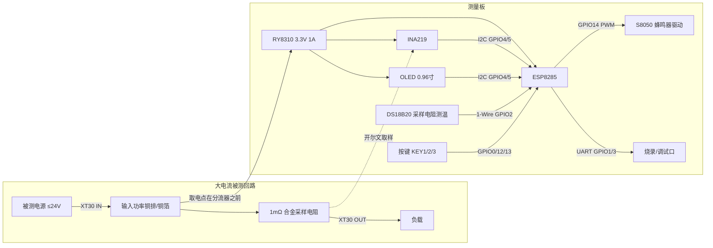

# ina219_ammeter 硬件设计方案

| 项目 | 内容 |
|---|---|
| 版本 | v0.1 |
| 日期 | 2026-10-17 |
| 状态 | 评审稿（原理图/PCB 前置设计输入） |
| 依据 | 用户引脚方案 + 本仓库 `hardware/datasheet/` 器件规格书 + TI INA219 数据手册 (SBOS448G) |

## 1. 概述

### 1.1 功能

串联在直流回路中的电流检测仪：INA219 测量分流电阻压降与母线电压，ESP8285 计算电流/功率并驱动 OLED 显示，按键交互，蜂鸣器告警，Wi-Fi 上报；DS18B20 检测采样电阻温度，用于温补与过温保护。

### 1.2 设计指标

| 指标 | 设计值 | 依据/备注 |
|---|---|---|
| 电流量程 | 0 ~ 40 A 可测；15 A 连续，30 A 峰值 | 1 mΩ 分流 + INA219 PGA=/1（±40 mV） |
| 电流分辨率 | 10 mA/LSB | 分流电压 LSB 10 µV ÷ 1 mΩ |
| 电流精度 | 出厂校准后 ±1%（目标） | 误差预算见 §5.6 |
| 母线电压 | 0 ~ 26 V 可测；本设计 ≤24 V | INA219 母线上限 26 V（绝对最大值） |
| 母线电压分辨率 | 4 mV/LSB | INA219 规格 |
| 温度检测 | −55 ~ +125 °C，±0.5 °C（−10~85 °C） | DS18B20 12 bit |
| 供电 | 被测回路取电（母线 ≤24 V）→ 3.3 V | RY8310 降压，1 A 连续/2 A 限流（§4）；输入 4.5~30 V（abs 32 V） |
| 显示 | 0.96" OLED 128×64（SSD1306，I2C） | |
| 通信 | Wi-Fi 2.4 GHz 802.11 b/g/n | ESP8285 |
| 明确排除 | 市电/高压回路、非直流测量、隔离测量 | 本方案为 SELV 直流共地系统 |

### 1.3 系统框图

**关键拓扑约束**：整机供电取电点必须在分流电阻**之前**（电源侧），测量板自身电流不流经分流电阻，测量值仅为负载电流。

## 2. 主控最小系统（ESP8285 芯片自绘）

引脚编号依据 `hardware/datasheet/0a-esp8285_datasheet_cn.pdf`（QFN32，5 mm × 5 mm，33 脚为 GND 焊盘）。

### 2.1 电源域与去耦

| 管脚 | 名称 | 处理 |
|---|---|---|
| 1, 30 | VDDA | 3.3 V；各就近 0.1 µF |
| 3, 4 | VDD3P3（功放） | 3.3 V；各就近 0.1 µF + 10 µF 储能紧靠芯片 |
| 29 | VDDD | 3.3 V；就近 0.1 µF |
| 11, 17 | VDDPST（IO） | 3.3 V；各就近 0.1 µF |
| 5 | VDD_RTC | **悬空**（规格书标注 NC，内部 1.1 V） |
| 31 | RES12K | **12 kΩ ±1% 到 GND**（必须） |
| 33 | GND | 大面积接地 + 多过孔 |

全部电源域 2.7 ~ 3.6 V，统一 3.3 V 供电。VDD3P3 走线短而宽（功放峰值电流），储能电容 ≥10 µF 紧贴 3/4 脚。

### 2.2 时钟

- 无源晶振 26 MHz（规格书允许 24 ~ 52 MHz；用 40 MHz 亦可）。
- 负载电容按晶振 $C_L$ 计算：$C_1 = C_2 \approx 2(C_L - C_{stray})$，$C_{stray}\approx 3\,\mathrm{pF}$；常见 $C_L=12\,\mathrm{pF}$ → 取 18 pF，最终按晶振规格书与实测频偏校准。
- 注意：26 MHz 晶振上电 boot log 波特率 74880，40 MHz 为 115200（固件调试时注意串口设置）。

### 2.3 复位与使能

- CHIP_EN（pin 7）：10 kΩ 上拉到 3.3 V + 0.1 µF 到 GND（RC 延时，满足 t4 上升时间 0~2 ms 与 t5 相对 EXT_RSTB 的时序要求）。
- EXT_RSTB（pin 32）：10 kΩ 上拉 + 复位按键到 GND（低有效）。
- U0TXD（pin 26）：**上电期间不得被外部下拉**（规格书明确要求），烧录口 TX 方向注意。

### 2.4 启动绑带与启动模式

ESP8266/ESP8285 平台既定启动绑带规则（规格书注明 GPIO2、GPIO0、MTDO 参与启动模式选择）：

| 条件 | 结果 | 本设计保障 |
|---|---|---|
| GPIO0=H, GPIO2=H, GPIO15=L | 正常运行（SPI 启动） | GPIO0 10 kΩ 上拉；GPIO2 由 DS18B20 总线 4.7 kΩ 上拉维持高；GPIO15 10 kΩ **下拉** |
| GPIO0=L（复位时） | UART 下载模式 | KEY1 按住复位即进入下载，属预期功能 |
| GPIO2=L 或 GPIO15=H（上电） | 启动异常/进入其他模式 | 已由上下拉排除；GPIO2 外挂器件必须开漏/高阻 |

### 2.5 Flash 与不可用引脚

- ESP8285 片内集成 Flash（1 MB 级，以采购批次规格为准）。
- GPIO6/7/8/9/10/11（SDIO_*，pin 18~23）连接片内 Flash，**不可用于其他功能**（规格书要求，SDIO 线上带 200 Ω 串联）。
- 因此可用 IO 仅：GPIO0/1/2/3/4/5/12/13/14/15/16 + TOUT。

### 2.6 射频（LNA → 天线）

- LNA（pin 2）：芯片输出阻抗 39 + j6 Ω；**必须保留 π 型匹配网络**（按 Espressif ESP8266 硬件设计指南取值，典型 3 元件 π：串臂电感/并臂电容组合，实板调谐）。
- 50 Ω 微带线（按层叠计算线宽）经 π 匹配到天线；天线选型：PCB 倒 F 天线（默认）或 IPEX/u.FL 座（金属外壳/外置天线时），预留 π 网络 + 两种天线焊位（其一 DNP）。
- 布局：天线净空区无铜、无器件；天线区远离大电流铜排、分流电阻与降压电感/开关节点（≥10 mm），大电流回路与 RF 分区。
- 注意：规格书页脚标注 **NRND（不推荐用于新设计）**，需评估供货周期并保留替代路径（见 §13）。

### 2.7 烧录与调试

- UART0：U0TXD（GPIO1）/U0RXD（GPIO3）引出 2.54 mm 4P 接口（3V3 / GND / TX / RX）。
- 下载方式：KEY1（GPIO0）+ 复位键手动进下载；可选 CH340C + USB-C 自动下载电路（DTR/RTS 控制 GPIO0/EXT_RSTB，DNP 选装）。
- GPIO2 可作烧写 Flash 时 UART1_TX（规格书），调试可观测。

## 3. 引脚分配

| GPIO | 芯片管脚 | 功能 | 上下拉 | 说明 |
|---|---|---|---|---|
| GPIO0 | 15 | KEY1（Boot 键） | 外部 10 kΩ 上拉 + 100 nF | 绑带脚；上电按住=下载模式；短/长按=界面操作 |
| GPIO2 | 14 | DS18B20 1-Wire DQ | 4.7 kΩ 上拉到 3.3 V | 绑带脚，必须维持上电为高（开漏总线天然满足） |
| GPIO4 | 16 | I2C SDA | 4.7 kΩ 上拉 | 接 INA219 + OLED |
| GPIO5 | 24 | I2C SCL | 4.7 kΩ 上拉 | 同上 |
| GPIO12 | 10 | KEY2 | 内部上拉 + 建议外部 10 kΩ + 100 nF | 低有效 |
| GPIO13 | 12 | KEY3 | 内部上拉 + 建议外部 10 kΩ + 100 nF | 低有效 |
| GPIO14 | 9 | 蜂鸣器驱动（PWM） | — | 经 1 kΩ 到 S8050 基极 |
| GPIO15 (MTDO) | 13 | 保留 | **10 kΩ 下拉到 GND** | 绑带脚上电必须为低；不再外挂 |
| GPIO16 (XPD_DCDC) | 8 | 保留 | — | 深度睡眠唤醒（接 EXT_RSTB 需求时使用），本设计不引出 |
| GPIO1 (U0TXD) | 26 | 烧录口 TX | — | 上电禁止外部下拉 |
| GPIO3 (U0RXD) | 25 | 烧录口 RX | — | |
| TOUT | 6 | 保留悬空 | — | ADC 输入限定 0~1.0 V；本设计不用 |
| GPIO6~11 | 18~23 | 片内 Flash | — | 禁止使用 |

## 4. 电源设计（RY8310 → 3.3 V）

### 4.1 输入与取电

- 取电点：XT30 输入侧铜排（分流电阻之前）。
- 输入范围：被测母线 ≤24 V；RY8310 工作输入 4.5~30 V、绝对最大 32 V、OVP 阈值约 30.8 V（规格书）。**24 V 母线 + 浪涌/热插拔尖峰不得顶到 30 V 以上**（§13 风险 1）。
- 输入保护链：取电支路串保险（1 A 慢断或自恢复 PTC，**只保护电子线路**，主电流通路不过保险）→ 串联肖特基 SS34（反接保护）→ TVS SMBJ26A（VRWM 26 V，24 V 母线下不导通）→ 串 0.5~1 Ω 电阻或磁珠 → 降压 IN 脚。SMBJ26A 大电流钳位（Ipp 级约 42 V）高于芯片 32 V 绝对最大值，靠串阻/磁珠 + IN 脚本地储能把芯片引脚尖峰压到 <30 V，**示波器实测 VIN 引脚尖峰为验收项**。
- 输入电容：22 µF/50 V X5R（规格书 CIN 建议值）+ 100 µF/50 V 电解（储能，抑制热插拔尖峰）。

### 4.2 RY8310 降压级

依据 `hardware/datasheet/RYCHIP-RY8310_Datasheet_V1.0.3.pdf`：**4.5~30 V 输入（abs 32 V）、1 A 连续输出（上管限流 2 A）、1.4 MHz、同步整流（无需续流二极管）、内置补偿与软启动（≤1 ms）、Force-PWM、SOT23-6**（1=BS、2=GND、3=FB、4=EN、5=IN、6=SW，顶标 GBYLL）。注意：市售信息常写 1.2 A，规格书口径为 **1 A 连续**，功耗预算按 1 A 连续核算（§4.3）。

- 反馈分压：$V_{out}=0.8\,\mathrm{V}\times(1+R_1/R_2)$（$V_{FB}$=0.800 V 典型，0.780~0.820）；3.3 V 取 $R_2=10\,\mathrm{k\Omega}$、$R_1=31.25\,\mathrm{k\Omega}$（规格书推荐表；E96 用 31.6 kΩ → $V_{out}\approx 3.33\,\mathrm{V}$）。
- 电感：4.7 µH（规格书 3.3 V 推荐值）；纹波 $\Delta I \approx 0.43\,\mathrm{A}$，峰值 ≈1.2 A → 饱和电流 ≥1.5 A。
- 电容：CIN 22 µF/50 V；COUT 2×22 µF X5R + 47~100 µF 聚合物/钽（**储能对付 Wi-Fi 发射瞬态**）；BST 电容 C1=100 nF（BS–SW 之间）。
- CFF（前馈电容）：芯片内置补偿，CFF 可选；**预留 DNP 焊位（10~100 pF）**，按 Wi-Fi 突发负载瞬态实测选装。
- EN：接 VIN（上升阈值 1.3 V，EN 绝对最大 32 V）；需 UVLO 时用分压设定；关断电流 8 µA。
- 最小导通时间：24 V→3.3 V 占空比 $D\approx 13.75\%$，$t_{on}=D/f_{sw}\approx 98\,\mathrm{ns}$，规格书 $t_{on(min)}=90\,\mathrm{ns}$——**高线余量仅 ~9%**，输入 >26 V 时顶到下限（纹波增大/跳脉冲），列为实测项（§13）。
- 保护：OCP 打嗝模式、OVP ≈30.8 V、过温关断、内部软启动 ≤1 ms。
- 布局：开关节点小、电感紧贴、输入电容回路最小、反馈走线远离开关节点、SOT23-6 下铺铜散热、地平面单点汇入。

### 4.3 功耗预算与裕量分析

3.3 V 轨负载（依据 ESP8285 规格书表 5-3 与外设规格）：

| 负载 | 典型 | 预算峰值 | 备注 |
|---|---|---|---|
| ESP8285 TX（802.11b +19 dBm） | 197 mA | 350 mA | 规格书 197 mA 为 **50% 发射占空比**条件；连续 TX 瞬时值更高，预算按 350 mA [INFERENCE，需实测] |
| ESP8285 RX | 72~73 mA | 75 mA | |
| OLED SSD1306 0.96" | 10~20 mA | 25 mA | 全亮峰值 |
| INA219 | ≤1 mA | 1 mA | 规格书上限 |
| DS18B20 | 1~1.5 mA | 2 mA | 转换期 |
| 蜂鸣器（选型 ≤20 mA） | 15 mA | 20 mA | 必须选低功耗蜂鸣片 |
| 其他/裕量 | — | 5 mA | |
| **合计** | ~300 mA | **~478 mA**（TX/RX 实际交替，此处按各项同时取峰值的保守和） | |

结论：3.3 V 轨峰值预算 ~478 mA，RY8310 额定 1 A 连续（限流 2 A），**裕量约 2 倍，供电能力充足**。保留以下工程措施：

1. 输出端储能电容与 CFF 焊位（§4.2）吸收 TX 突发，抑制瞬态跌落；
2. 蜂鸣器 ≤20 mA 选型，持续鸣叫用短促节拍；
3. 打样后实测：3.3 V 轨瞬态（TX 连发/最大发射功率工况）、RY8310 温升、24 V 高线下的输出纹波。

## 5. 电流检测（INA219 + 1 mΩ 合金采样电阻 + 铜排加强）

### 5.1 量程与分辨率

| 参数 | 计算 | 结果 |
|---|---|---|
| 分流电阻 | 用户定案 | 1 mΩ 合金（锰铜系），2512/3920 封装，≥2 W，±1%（推荐 0.5%） |
| INA219 量程 | PGA=/1，±40 mV | ±40 A（15 A 时 15 mV，30 A 时 30 mV） |
| 分辨率 | 10 µV ÷ 1 mΩ | 10 mA/LSB |
| 分流功耗 | $P=I^2R$ | 15 A→0.225 W；30 A→0.9 W；40 A→1.6 W（2 W 以上电阻裕量足够） |
| 负担电压 | $I\times R$ | 15 mV@15 A，负载侧压降可忽略 |
| 满量程误差位 | 失调 ±10 µV 典型（PGA/1） | 折合 ±10 mA；INA219A 最大 ±100 µV（±100 mA），**建议选 INA219B**（±50 µV）并做零点校准 |

PGA 选 /1 的原因：1 mΩ 在 15 A 时仅 15 mV（30 A 时 30 mV），/1 量程（±40 mV）已覆盖 40 A，且失调最小。

### 5.2 开尔文取样与滤波

- **取样点必须紧贴采样电阻端头内缘**（四线开尔文）。1 mΩ 量级下，焊盘/焊料/铜箔电阻约 0.1~0.3 mΩ，与分流器同数量级；取样点每偏离 0.1 mΩ = 10% 电流误差。工艺要求：大焊盘、吃锡饱满、取样走线自焊盘内缘引出且不承载主电流。
- 滤波：IN+/IN− 各串 10 Ω（同批次 ±1%，主要误差来自失配，等效 ≤ 数 mA），差分 100 nF，各 1 nF 到 GND。若实测失调异常，可换 0 Ω 跳线焊位。
- 取样走线：双绞/平行走线，远离开关电源与大电流铜排，禁止与功率回路共用铜皮。
- INA219 外围：VS（3.3 V）0.1 µF 去耦；A0=A1=GND → 地址 **0x40**；IN− 同时是母线电压取样点（读数=分流器**负载侧**电压，电源侧电压 = 读数 + I×0.001）。

### 5.3 大电流功率回路（XT30 + 铜排加强）

- 通路：XT30-IN → 输入铜排/铜箔 → 1 mΩ 合金采样电阻 → 输出铜排/铜箔 → XT30-OUT。
- 过流加强：功率路径 2 oz 铜箔 + 大面积露铜堆锡，其上**焊接铜排**（如 0.5~1.0 mm × 5~8 mm 镀锡紫铜排）并行载流；合金电阻跨接在两段铜面之间，两端铜排向电阻端头汇流，取样线在电阻端头内缘引出。
- 载流估算：15 A 连续按 10 A/mm² 铜排经验载流，截面 ≥1.5 mm² 即满足（按 ≥2 mm² 设计留裕量）；PCB 铜箔部分按 IPC-2152 温升曲线校核，不足则加厚锡层/铜排。
- 连接器：XT30（公/母各一，丝印区分防插反）。**连续 15 A 即 XT30 常见标称上限（随线径变化），无余量**[INFERENCE，须按 AMASS 规格书确认]；30 A 峰值仅允许短时，持续时间按连接器温升实测限定。必须实测连接器温升（环境 25 °C 下壳体温升 ≤30 K），越限则升级 XT30U/XT60 或双 XT30 并联，焊盘预留改版空间。

### 5.4 温度与温补

- DS18B20 贴装于采样电阻近旁（同面或背面正对，导热胶/热缩固定），反映分流器温度。
- 合金电阻温漂典型 ±50 ppm/°C 级[INFERENCE，按所选电阻规格书为准]；但焊盘/铜箔温漂约 +3900 ppm/°C，是漂移主要来源 → 温补 + 出厂校准双管齐下。
- 过温保护：分流器温度 >80 °C 告警（蜂鸣器），>100 °C 降额/提示（阈值固件可配）。

### 5.5 INA219 接口特性（固件注意）

- I2C 从地址 0x40；与 OLED（0x3C/0x3D）无冲突。
- 转换时间 532 µs（12 bit）；SMBus 超时 28 ms——SDA/SCL 低电平不得超过 28 ms，否则接口复位（固件阻塞需注意）。

### 5.6 误差预算（15 A 点，校准后目标）

| 误差来源 | 典型 | 折合 | 处理 |
|---|---|---|---|
| 分流电阻容差 ±1% | 1% | ±0.15 A | 选 0.5% 或出厂校准 |
| INA219 综合测量误差（规格书 Current measurement error） | ±0.2% 典型（±0.5% 最大） | ±0.03 A | 校准 |
| INA219 失调（零点校准后残留） | ±5 µV 级 | ±5 mA | 上电/空载零点校准 |
| 焊盘/铜箔电阻与温漂 | 0.1~0.3 mΩ | 未校准可达 +1.5~4.5 A | 开尔文 + 校准 + 温补 |
| 温漂（合金+铜，全温区） | — | ±0.3% 级 | DS18B20 温补 |
| **合计（校准后）** | — | **±1%（目标）** | 校准方案见 §14 |

## 6. 温度检测（DS18B20 @ GPIO2）

- 接线：VDD = 3.3 V（**正常供电模式，禁止寄生供电**），DQ → GPIO2，DQ 4.7 kΩ 上拉到 3.3 V，VDD 旁 100 nF。
- 与 GPIO2 绑带约束的关系：1-Wire 总线空闲为高（开漏 + 上拉），上电时 GPIO2 被 4.7 kΩ 维持为高，满足"正常启动"要求；固件在上电早期不要强驱动 GPIO2 为低。
- 时序：12 bit 转换最长 750 ms；显示/告警温度刷新 ≥1 s/次即可。
- 外置探头（可选）：若引出线 >30 cm，上拉改 2.2 kΩ，串联 100 Ω + ESD 保护，屏蔽线就近接地。

## 7. 显示（0.96" OLED，SSD1306，I2C）

- 4P 接口（GND / VCC / SCL / SDA），2.54 mm 插座；VCC 接 3.3 V（模块须支持 3.3 V 供电/电平，5 V 供电型模块不适用直连）。
- 地址 0x3C（默认）/0x3D（由模块电阻决定）；与 INA219 0x40 无冲突。
- I2C 上拉：板上单组 4.7 kΩ 到 3.3 V（若 OLED 模组自带上拉，二选一，避免并联 <1 kΩ）；总线 ≤400 pF，400 kHz。

## 8. 按键

| 按键 | GPIO | 电路 | 功能建议 |
|---|---|---|---|
| KEY1 | GPIO0 | 10 kΩ 上拉 + 100 nF 对地（必须外部上拉） | 短按切换页面/确认；长按进入设置/校准；上电按住=下载模式 |
| KEY2 | GPIO12 | 内部上拉 + 建议外部 10 kΩ + 100 nF | 加/上翻 |
| KEY3 | GPIO13 | 同上 | 减/下翻 |

全部低有效；固件软件消抖 20 ms。

## 9. 蜂鸣器（GPIO14）

- 驱动：GPIO14 → 1 kΩ → S8050 基极；发射极 GND；集电极接蜂鸣器负端；正端接 3.3 V；磁式蜂鸣器并 1N4148 续流。
- 选型：**无源蜂鸣片（≤20 mA）**，PWM 2~4 kHz 可变音调（告警/按键音）；同一焊位兼容有源蜂鸣器（仅开关控制）。
- 电流计入 §4.3 预算；持续鸣叫用短促节拍降低平均电流。

## 10. 保护与安全

- 仅适用于 ≤26 V 的 SELV 直流回路；**禁止用于市电/高压/隔离测量场合**。
- 输入保护链见 §4.1；按键/烧录口按 ESD 接触放电 ±4 kV 目标预留 TVS/RC（可选）。
- 反接：SS34 串联（电子线路支路）；主功率回路靠 XT30 防呆（公/母区分）与丝印警示。
- 熔断：电子支路 1 A；主回路建议外置保险按负载选型（15 A 级快断/慢断由应用场景定），不建议在测量板内熔断主电流。

## 11. PCB 设计要点

1. 分区：大电流功率区（XT30、铜排、采样电阻）/ 电源区（RY8310）/ RF 区（天线净空）/ 小信号区（INA219、按键、OLED）。
2. 叠层：2 层板可做，功率区 2 oz 铜 + 堆锡 + 铜排；RF 50 Ω 微带按实际叠层计算线宽。
3. 开尔文取样线：自电阻端头内缘引出，双线并行/双绞，不与功率铜皮共用路径，不过开关节点下方。
4. 地：功率地与信号地单点汇合（INA219 GND 靠近取样参考点）；RF 地完整。
5. 天线净空区禁止铺铜/走线/器件；远离铜排 ≥10 mm。
6. 热：采样电阻与铜排留散热铜面积；DS18B20 紧邻采样电阻；RY8310 下方铺铜散热。
7. 丝印：XT30 IN/OUT、极性、15 A 连续 /30 A 峰值 /24 V 额定警示、版本号。

## 12. 主要物料清单（BOM 摘要）

| 位号 | 器件 | 规格 | 数量 | 备注 |
|---|---|---|---|---|
| U1 | ESP8285 | QFN32 5×5，片内 1 MB Flash | 1 | 规格书标注 NRND，注意供货 |
| U2 | INA219B | SOT-23-8 | 1 | A0=A1=GND（0x40）；B 级低失调 |
| U3 | RY8310 | 30 V/1 A 连续，1.4 MHz 同步降压，SOT23-6 | 1 | 外围按规格书：R1=31.25 kΩ、R2=10 kΩ、L=4.7 µH、C1=100 nF |
| U4 | DS18B20 | TO-92 或 SOIC | 1 | 贴装于采样电阻旁 |
| R_sh | 合金采样电阻 | 1 mΩ ±1%（推荐 0.5%）≥2 W，2512/3920 | 1 | 开尔文取样 |
| Y1 | 无源晶振 | 26 MHz（或 40 MHz） | 1 | 负载电容按 §2.2 |
| L1 | 功率电感 | 4.7 µH，Isat ≥1.5 A | 1 | 规格书 3.3 V 推荐值 |
| D1 | 肖特基 | SS34（3 A/40 V） | 1 | 仅反接保护；RY8310 同步整流无需续流管 |
| D2 | TVS | SMBJ26A | 1 | 母线保护 |
| Q1 | S8050 | SOT-23 | 1 | 蜂鸣器驱动 |
| OLED1 | 0.96" OLED | SSD1306 I2C 128×64，3.3 V | 1 | 4P 插座 |
| J1/J2 | XT30 | 公 + 母 | 各 1 | 载流风险见 §5.3 |
| — | 铜排 | 0.5~1.0 mm × 5~8 mm 镀锡紫铜 | 2 段 | 过流加强 |
| KEY1~3 | 轻触按键 | 6×6 | 3 | |
| BZ1 | 无源蜂鸣片 | ≤20 mA | 1 | |
| — | 阻容 | 上拉/去耦/滤波若干 | — | 见各节取值 |

## 13. 风险与待确认清单

| # | 事项 | 影响 | 动作 |
|---|---|---|---|
| 1 | RY8310 输入 30 V 上限（abs 32 V，OVP ≈30.8 V）vs 24 V 母线尖峰与 TVS 大电流钳位（约 42 V） | 芯片过压损坏 | §4.1：TVS + 串阻/磁珠 + IN 脚储能；示波器实测 VIN 尖峰 <30 V 为验收项 |
| 2 | 24 V→3.3 V @1.4 MHz 导通 ≈98 ns vs t_on(min) 90 ns | 高线（>26 V）纹波增大/跳脉冲 | 实测 24 V 上限工况纹波与负载调整率 |
| 3 | XT30 连续 15 A = 常见标称上限，无余量；30 A 峰值短时 | 连接器过热/压降 | 核对 AMASS 规格书 + 实测温升 ≤30 K；备选 XT30U/XT60 |
| 4 | 1 mΩ 量级的焊盘/铜箔电阻与温漂 | 精度主误差源 | 开尔文工艺 + 出厂校准 + 温补；高精度需求改四端子分流器 |
| 5 | ESP8285 规格书标注 NRND | 供货/生命周期 | 备选方案评估（模组方案/替代 SoC） |
| 6 | 蜂鸣器具体型号/电流 | 功耗预算 | 选型 ≤20 mA |

## 14. 与固件的接口约定

- GPIO 映射见 §3；I2C：SDA=GPIO4、SCL=GPIO5，INA219=0x40，OLED=0x3C/0x3D；1-Wire=GPIO2。
- INA219 配置：PGA=/1、BRNG=1、12 bit 连续或触发转换；电流 LSB = 10 mA（校准寄存器按 1 mΩ 计算）。
- 校准流程：上电/空载零点校准（采样 100 次取均值作失调）；出厂增益校准（对照标准表，校准系数入 NVS）；DS18B20 温补表/系数入 NVS。
- `esp_init_data_default.bin`：TOUT 悬空；`vdd33_const` = 0xFF（内部测 VDD3P3）或 33（3.3 V），二者择一，推荐 0xFF。
- 蜂鸣器：GPIO14 PWM（2~4 kHz）；按键：GPIO0/12/13 低有效，软件消抖 20 ms。
- Wi-Fi 发射功率不受供电限制（RY8310 1 A 连续裕量）；节能需求可配置降低 TX 功率/占空比。

## 15. 下一步

1. 补齐 XT30（AMASS）/ 采样电阻规格书入库 `hardware/datasheet/`；
2. 画原理图（KiCad/立创 EDA），按本方案核对 §13 清单；
3. PCB 布局（重点：开尔文、RF 净空、功率散热）；
4. 打样后实测验证项：3.3 V 轨瞬态、XT30 温升、零点/满量程精度、Wi-Fi 吞吐下的测量稳定性。
